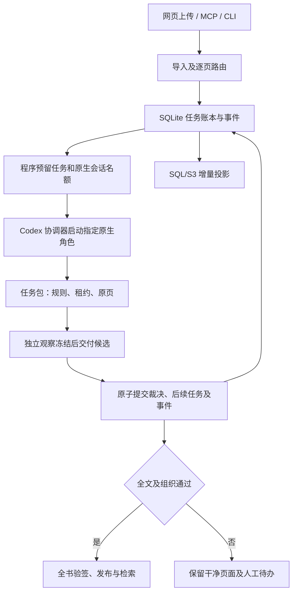

# 事务化 Codex 执行引擎

本次替换任务写入、调度和投影主链。原上传、单用户终审、阅读、脚注、目录、检索、导出及已发布记录继续使用现有业务契约。原生提取只是候选，Terra 识别、Sol 原图优先审核与独立修正复核的要求不变。

本地测试、真实史料及性能对比结果见[验收记录](EXECUTION-ENGINE-VALIDATION-20261105.md)。

后续原图预读、可配置并发、暖代理复用和即时发布以[吞吐策略](THROUGHPUT-20261106.md)为准；本文件保留事务存储、证据、迁移与恢复的架构说明。

## 职责与调用

| 责任 | 唯一实现 | 对外边界 |
| --- | --- | --- |
| 导入及业务命令 | `application.py`、`Store` 和各 workflow | CLI、MCP、平台适配器调用相同用例 |
| 写入权威及事件 | `ledger.py`、`checkpoints.py` | SQLite/WAL；字段、页面、任务独立版本；JSON 为兼容导出或封存输入 |
| 原生会话与准入 | `dispatch.py`、`scheduling.py` | 预留具体租约及全工作区名额，返回明确角色和 session token |
| 执行适配 | `runner.py`、`execution.py`、`runtime_context.py` | 监督有界 CLI 协调进程；模型推理全部由原生 Codex 子代理执行 |
| 原件与裁决证据 | `evidence.py`、`task_inspection.py`、`details.py` | 原图、分段候选、观察和修改绑定哈希 |
| SQL/S3/检索投影 | `services/native/changes.py`、`CodexBridge` 及已有投影用例 | 消费持久事件，沿用短 SQL CAS 提交和不可变对象引用 |



主协调器只转交程序给出的任务，不再反复决定批次分配。`dispatch_work` 在启动代理之前预留任务及名额；`open_task_packet` 一次交付阶段规则、冻结策略、租约和原页像素。审核与复核在冻结原图观察前看不到候选，`freeze_observations` 返回候选的首个完整区间，其余区间仍须全部读取。`submit_packet` 返回最小回执，重复提交相同输入与结果返回已有回执，不生成重复后续任务。

每工作区最多七个工作代理，包含 `starting / idle / busy / cooldown`。预热审核代理可以等待事件；每会话至多两页，另有到期回收、启动失败释放和退出记录。识别与审核沿用耗时比例及三十秒稳定窗口；独立逐页复核可以使用其余空位，目录和整书组织仍按依赖执行。现有页面不因重分配而中断。两个 CLI 协调进程可监督不同书籍，Python 线程不充当模型代理。

## 一致性与恢复

- `records` 按文档字段、物理页和任务分别存储版本，`documents` 保存文档提交版本。写入只修改发生变化的记录，同记录冲突拒绝旧提交，不同页改动可合并。
- 结果、后续审核/复核/组织任务、会话结果及 `events.sequence` 在同一 SQLite 事务中提交。只读状态走 WAL 已提交版本；新建读取对象也不等待命令互斥锁。
- 日常证据检查覆盖当前页及其历史依赖。原 PDF 和选中页内容仍重新计算哈希，不以文件修改时间或过往模型批准代替校验。发布、迁移、完整恢复验收和定期审计执行全书检查。
- 平台按事件选取变化文档；重启从持久事件重新消费，已有 SQL CAS 和内容地址对象使重放安全。未变文档不再逐秒重建投影，另保留每分钟对账与审计；索引新发布版本前再次全书检查。
- 等待有效工作代理使用 `waiting_workers`，不增加技术失败。限流、超时、断线记录技术退避；原件不清、修改无法定位或复核不通过保留人工待办。三次普通重试及一次既有检查点恢复策略保持有界，旧任务不擅自启用新策略。
- 人工草稿、决定、旧发布版本与证据不因技术恢复重写。明确恢复会清除当前错误显示，失败详情保留在历史中。没有新建史料卡任务。

## 从旧 JSON 工作区升级

新工作区自动使用 `ledger.sqlite3`。包含旧 `document.json` 的工作区默认只读，避免在旧进程仍写 JSON 时自动接管。升级顺序如下：

1. 停止该工作区的 API、工作台、CLI 协调器和工作代理，确认没有有效执行租约。先创建并保留完整旧版本备份。
2. 使用新版本运行迁移命令，显式指定原工作区，避免选错独立验收目录：

   ```powershell
   uv run --no-sync --project services/codex-pipeline --locked python -m hrs_codex.cli --root 'D:/workspace' migrate-ledger
   ```

3. 迁移验证全量证据，核对文档、页面、任务和人工记录语义一致，再原子切换账本。旧文件逐字节封存为 `document.legacy.json`，`.ledger-migration.json` 记录来源哈希及切换状态。切换中断时保持停止状态，重复相同迁移命令完成封存，不运行双写。
4. 用新版本启动 API/工作台。被暂停或耗尽旧重试额度的任务继续保留状态，不会因迁移自行恢复识别。

原生备份 v2 使用 SQLite backup 接口包含已提交 WAL 内容；恢复仍只允许新目录，并验证所有归档成员哈希。v1 JSON 备份可继续读取，恢复后须按上述步骤升级才能写入。回退必须同时恢复对应应用版本和一致工作区备份；封存 JSON 只代表迁移时刻，不能覆盖迁移后产生的新裁决。

本次对正式 825 页任务只做独立副本迁移及压力验证，正式目录和原容器数据保留。

## 执行上下文及观测

本机 Codex CLI 0.148.0 已实测支持独立执行目录与 `--ignore-user-config`。适配器只保留当前提供方的最小账号路由配置，继续使用现有登录；不会复制凭据或修改全局设置。无关开发 skills、apps、plugins 和 hooks 不进入处理上下文。固定角色仍为 Terra OCR、Sol 审核/复核及组织，不能因模型容量错误而静默换模型。

阶段回执包含排队、启动、原页阅读和候选比较耗时；速度使用实际采样窗口，窗口不足五分钟时不固定除以五。网页同时展示启动中、处理中、等待任务及工作区占用数。运行日志和证据保留在工作区内。

本次采用单一职责、明确分层、短事务、有限并发和可诊断异常等原则，参考[阿里工程分层](https://github.com/alibaba/p3c/blob/master/p3c-gitbook/工程结构/应用分层.md)、[并发处理](https://github.com/alibaba/p3c/blob/master/p3c-gitbook/编程规约/并发处理.md)及[异常处理](https://github.com/alibaba/p3c/blob/master/p3c-gitbook/异常日志/异常处理.md)。SQLite、原生会话及模块边界是本项目的工程选择，并非该手册指定技术。Codex 配置能力参考 [OpenAI 配置文档](https://developers.openai.com/codex/config-reference/)，实际参数同时经过本机 CLI 与真实任务验证。
