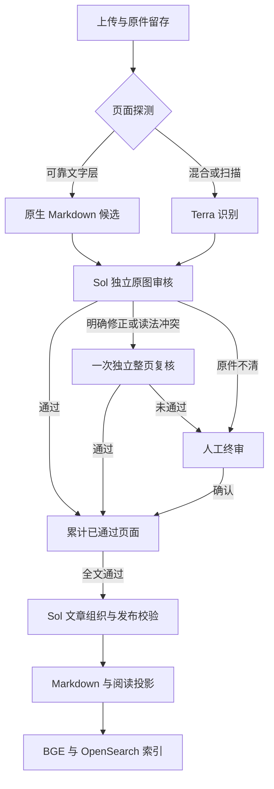

# Historical Research System

面向单人使用的本地史料处理系统。导入 PDF 或图片后，由 Codex 原生子代理完成识别、独立原图审核和文章组织；本地程序保存原件与审核证据，并提供人工核对、阅读、检索和 Markdown 导出。

- **内容处理**：按页选择原生文字候选、混合识别或整页 OCR；Terra 负责识别，Sol 负责独立审核、修正复核和组织。
- **人工终审**：对照疑点文字和原图，保留或修改后确认；草稿、旧版本及原件保留。
- **资料使用**：保留脚注双向跳转、表格与插图证据，目录与搜索复用正文定位。

## 环境要求

以下完整平台命令面向 **Windows PowerShell**，全部在仓库根目录执行。

| 依赖 | 要求 |
| --- | --- |
| Python | 3.11；平台依赖限定为 `>=3.11,<3.12` |
| uv | 安装与运行锁定的 Python 项目环境 |
| Node.js / npm | Node.js 24 或更新版本，用于安装和构建工作台 |
| Docker Desktop | Linux 容器引擎已启动，可运行 Docker Compose |
| Codex CLI | 已安装、已登录，并能使用项目配置的 Terra/Sol 原生子代理模型 |
| 检索模型 | 本地 BGE-M3 与 BGE reranker 权重，准备方法见[模型说明](models/README.md) |
| GPU | 默认检索使用 CUDA，需要兼容的 NVIDIA 驱动；CPU 检索必须显式配置 |

独立 MCP 工作台只需要 Python、uv 和 Codex CLI，不依赖 Docker、SQL/S3 或 BGE。其安装与使用见 [Codex 模块](services/codex-pipeline/README.md#独立使用)。

## 快速开始

### 1. 准备配置

首次使用时复制配置模板，已有 `.env` 时保留原文件：

```powershell
if (-not (Test-Path -LiteralPath '.env')) {
    Copy-Item -LiteralPath '.env.platform.example' -Destination '.env'
}
```

用编辑器填写 `.env` 中的三项凭据，并核对部署身份：

| 配置 | 用途 |
| --- | --- |
| `INGEST_DEV_DB_PASSWORD` | 本地 PostgreSQL 密码 |
| `INGEST_S3_ACCESS_KEY` | 专用 S3 访问键 |
| `INGEST_S3_SECRET_KEY` | 专用 S3 密钥 |
| `COMPOSE_PROJECT_NAME` | 新安装留空；已有部署填写或保留原项目名 |

默认地址、端口、库名和存储桶由代码与 Compose 提供，数据库连接在内存中派生，`init` 不向 `.env` 回写配置。独立 MCP 不需要这份文件；原生识别与审核不依赖本地 OCR／视觉权重或 DeepSeek 密钥。默认值、兼容覆盖和备份配置详见[平台 README](services/research-platform/README.md)。

已有环境应保留 Compose 项目名和凭据，它们关系到现有容器与卷的归属。

### 2. 安装运行环境

默认 GPU 启动器从固定目录启动检索服务。每次打开新的平台终端，先设置以下环境路径；各模块的 `uv run` 命令继承此设置：

```powershell
$env:UV_PROJECT_ENVIRONMENT = [System.IO.Path]::GetFullPath('.cache/engineering-envs/research-platform')
uv sync --project services/research-platform --locked --group dev --extra retrieval
npm --prefix services/review-workbench ci
codex login status
```

`--extra retrieval` 安装 BGE 所需的 PyTorch、Transformers 等依赖。继续按[模型说明](models/README.md)准备固定版本的检索权重。CPU 检索同样需要这些依赖和权重。

安装与常驻运行分开：后续启动使用 `--no-sync`，避免运行中的环境被安装步骤改写。已有服务运行时，先停止所属启动器，再更新依赖。

### 3. 初始化并启动

```powershell
uv run --no-sync --project services/research-platform --locked python scripts/hrs_v2.py init
uv run --no-sync --project services/research-platform --locked python scripts/hrs_v2.py up --build
```

`init` 准备基础服务、专用业务/测试数据库、数据库迁移和上传服务；`up --build` 构建前端并在主机启动 API、工作台与原生执行器。后续前端没有变更时可省略 `--build`。

启动日志出现 `Research workbench: http://127.0.0.1:18170` 后，在浏览器打开 [工作台](http://127.0.0.1:18170)。默认主机入口固定为 18170；旧容器 Web 的 18156 端口配置不改变该入口。

### 4. 检查安装

在设置了相同运行环境的另一个终端执行：

```powershell
uv run --no-sync --project services/research-platform --locked python scripts/hrs_v2.py status
uv run --no-sync --project services/research-platform --locked python -m hrs_platform.cli doctor
```

`status` 查看工作区及本机监听状态；平台 `doctor` 检查数据库、S3、OpenSearch 和 Codex 登录等依赖。`/health/live` 与 `/health/ready` 可用于查看服务健康。检索模型是否可用还需在一份已完成入库的资料上实际检索，单纯端口可达不代表所有模型已就绪。

## 日常使用

1. 在书架上传 PDF。上传完成后自动进入同一持久队列，无需再到聊天中重复导入；图片可通过独立 CLI/MCP 导入。
2. 在“处理进展”查看识别、审核、通过与待人工数量。识别结束或审核结束都不等于全书已通过。
3. 在“内容核对”对照疑点原图，选择保留或修改并提交本页；离开页面保存的草稿不会放行内容。
4. 对目录冲突确认正文起点，或明确选择不设置跳转。PDF 物理页序与书内印刷页码分别处理。
5. 全部页面通过、文章组织和目录解析任务完成后，发布 Markdown；平台继续建立阅读投影和检索索引。
6. 入库后阅读、搜索或导出资料。目录关联争议可以单独保留待办，不会被伪装成已确认跳转。



正文、脚注归属、表格、插图和原件证据需要贯穿审核、组织与导出。机器裁决和人工决定分别记录；流程测试或工程测试通过不证明史料准确率。

## 工作区与文件

默认原生根目录由 [.codex/historical-workspace.json](.codex/historical-workspace.json) 指定，通常为 `state/codex`。任务、页面与会话的现役状态保存在 `ledger.sqlite3`，原件、页图、修订和发布文件保存在该工作区；完整平台还使用 PostgreSQL、S3 与 OpenSearch。

| 入口 | 选择原生工作区的方式 |
| --- | --- |
| 完整网页平台 | `.env` 的 `PLATFORM_CODEX_ROOT`；未设置时使用共享默认根 |
| CLI | `--root`、进程环境变量 `HRS_CODEX_ROOT`、共享默认根，依次取值 |
| Codex 对话 MCP | 进程环境变量 `HRS_CODEX_ROOT` 或共享默认根；连接启动后生效 |

对同一本资料操作前，核对界面、CLI 与 MCP 返回的 **workspace_id** 是否一致。仅修改平台的 `.env` 不会自动切换已经连接的对话 MCP。不要因为看不到已有任务就在另一个工作区重复导入。

备份应在执行器与上传写入停止后进行，采用平台协调备份，并独立保存 S3 业务对象。恢复到新的数据库与不存在的新原生目录；操作步骤见[平台备份说明](services/research-platform/README.md)。

## 在 Codex 对话中使用

[项目 MCP 配置](.codex/config.toml)注册 `historical_research`，角色定义位于 [.codex/agents](.codex/agents)，对话入口由 [historical-research Skill](.agents/skills/historical-research/SKILL.md)提供。先按[独立模块安装说明](services/codex-pipeline/README.md#独立使用)准备该配置引用的 Python 环境，再重新连接项目 MCP。

可以请求“使用 historical-research 处理指定 PDF，并打开工作台”。对已在网页上传的资料，提供现有文档或书籍标识继续处理，避免再次导入。本地协调器通过 `codex exec` 分派原生子代理，MCP 保存状态与校验证据，不执行模型推理。

## 停止与故障恢复

在启动器终端按 `Ctrl+C`，或从相同平台环境执行：

```powershell
uv run --no-sync --project services/research-platform --locked python scripts/hrs_v2.py stop
```

该命令请求停止所属主机启动器和执行器，保留检查点；共享存储、OpenSearch 与上传容器的停止方式见[基础设施 README](deploy/infrastructure/README.md)。暂停某一本资料使用进展页的暂停操作，继续时明确点击继续。

| 现象 | 处理方式 |
| --- | --- |
| Docker 无法连接 | 先确认 Docker Desktop 的 Linux 引擎已就绪，再启动平台 |
| 缺少 `.env` 或数据库认证失败 | 按配置模板核对地址、账号和容器初始化凭据，不覆盖现有业务卷 |
| 18170 已占用 | 核对已有启动器，使用已有工作台或先正常停止其所属实例 |
| GPU 检索环境或权重缺失 | 核对固定 Python 环境与[模型目录](models/README.md)；CPU 模式也需显式配置 |
| 一直等待人工 | 完成内容终审或目录决定；保存草稿不等于确认通过 |
| 处于技术冷却或重试中 | 按界面提示等待有限退避，保留检查点；其他可执行页面继续处理 |
| 自动恢复预算耗尽 | 修复故障后使用“从断点恢复”，不重新上传或删除已完成结果 |
| 原件或证据哈希不一致 | 恢复原文件后重新校验，不能修改哈希强行通过 |
| 目录位置不确定 | 进入目录核对选择实际正文位置，或明确不建立跳转 |

主机启动日志与控制记录在 `.cache/platform-diagnostics/`；原生运行事件在工作区 `runs/`。排障时保留相应记录，分享前去除凭据与访问令牌。旧 JSON 工作区需要停机执行账本迁移，见[原生模块说明](services/codex-pipeline/README.md#旧工作区迁移)。

## 开发验证

继承前述平台运行环境，在根目录执行无模型的原生测试：

```powershell
uv run --no-sync --project services/research-platform --locked python -m pytest services/codex-pipeline/tests --basetemp .cache/readme-native-tests -q
npm --prefix services/review-workbench test
npm --prefix services/review-workbench run build
```

平台集成测试需要专用测试数据库和存储，前端接口变更需同步 OpenAPI 与客户端类型；分别见[平台测试](services/research-platform/README.md)和[前端契约说明](services/review-workbench/README.md)。真实史料验收使用独立工作区，保留原件与机器证据，未解决内容交人工。

## 模块导航

| 模块 | 职责与文档 |
| --- | --- |
| 原生处理与 MCP | [services/codex-pipeline](services/codex-pipeline/README.md) |
| 平台 API、持久化与检索 | [services/research-platform](services/research-platform/README.md) |
| 上传、核对与阅读界面 | [services/review-workbench](services/review-workbench/README.md) |
| 共享运行组件 | [packages/runtime-support](packages/runtime-support/README.md) |
| 存储与检索部署 | [deploy/infrastructure](deploy/infrastructure/README.md) |
| 模型目录与安装 | [models](models/README.md) |
| 旧转换模块 | [services/document-extraction](services/document-extraction/README.md) |
| 检索评测工具 | [Ragas 工具](services/research-platform/evaluation/tools/ragas/README.md) |
| 本地历史参考资料 | [evaluation/reference](evaluation/reference/README.md) |

默认处理不依赖旧 Temporal、Qwen/Paddle OCR 或 DeepSeek 链路。已有历史数据和历史卡片保留读取与导出；新史料卡生成已退出。只有显式选择 `--legacy` 才启动兼容部署，具体前提见平台模块。

## 仓库跟踪范围

Git 保留业务源码、测试及必需数据、API 契约、部署配置和 README。实际执行使用的 `SKILL.md` 与 `workflow.md` 作为运行资源保留。辅助报告、验收快照、截图、日志、史料和本地工作区由 [.gitignore](.gitignore)排除，不能从 README 链接未分发的本地记录。

提交前核对 `git diff --check`、README 链接和配置示例；源码或命令入口变更时，同一 PR 更新对应 README。CI 拒绝跟踪符合忽略规则的本地文件。问题反馈应附复现步骤、脱敏错误与受影响模块，保留原件及人工修改。
