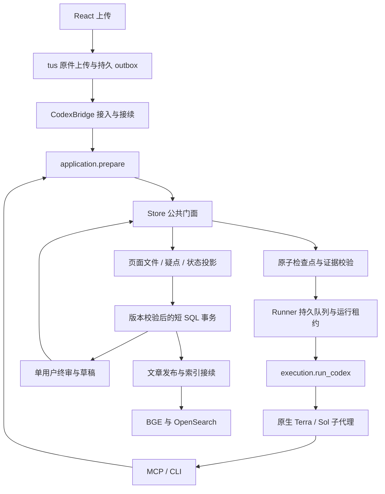

# 全项目重构后的调用与维护边界

本文件记录第一阶段职责重构；检查点存储、执行调度、增量投影及迁移恢复的最终实现以[事务化执行引擎](EXECUTION-ENGINE-20261105.md)为准。

这次重构在一个分支内连续完成，统一验证后提交一个 PR。采用阿里规范中的职责分层、显式依赖、可理解命名、短事务和异常分类原则，按 Python/React 的现有工程实现；不引入 Java 式空服务层、通用工具大类或第二套存储框架。

## 当前运行路径

入口负责协议适配。`application.prepare` 留存和探测原件并冻结处理策略；它不导入 CLI、MCP 服务或 HTTP 界面。`execution.run_codex` 拥有协调器子进程及退出清理；Runner 不再从 CLI 获取执行实现。MCP 服务注册工具并转换错误，本身不执行模型推理。

完整网页由平台桥接层直接管理 Runner 的启动和停止，上传、继续与恢复不再依赖另外启动一个工作台进程。独立 MCP 工作台继续提供同一队列入口；既有文档租约和执行锁防止同一任务重复执行。文章整理代理也可在自己的有效租约及冻结页面范围内取得原图，不借用审核租约。

## 原生核心的职责

| 模块 | 责任 |
| --- | --- |
| `store.py` | 保留既有公共调用签名，显式组合用例；不通过继承或 mixin 隐藏依赖 |
| `checkpoints.py` | 路径约束、原子 JSON、锁外校验与提交前快照比较 |
| `evidence.py` | 原件、文字、原图观察、细节与机器决定的哈希绑定；每轮重新校验 |
| `source_import.py` / `task_inspection.py` | 原件导入、原图读取、原图观察与候选文字访问记录 |
| `task_workflow.py` / `task_results.py` | 任务租约、提交共通门禁，以及各阶段的内存状态变更 |
| `workflow_rules.py` / `contracts.py` | 任务与继续执行规则、各实体状态名称和机器回执类型 |
| `run_workflow.py` / `recovery.py` | 协调器租约、暂停、失败预算、断点恢复和恢复回执 |
| `human_review_workflow.py` | 待办、版本绑定的草稿与最终人工决定 |
| `navigation_workflow.py` / `publication_workflow.py` | 目录决定、文章覆盖、发布版本与已发布文本检索 |
| `backup.py` | 停机原生快照、逐文件摘要、恢复到新目录 |

外部服务使用 `document_directory`、`artifact_path`、`verify_evidence` 和 `review_packet`，不再依赖 Store 的私有路径及审核包方法。检查点仓库只向需要事务的内部用例暴露。

`EvidenceMismatch`、`LeaseConflict`、`WorkflowStopped` 提供稳定类别，继续继承 `ValueError`，保留原错误说明。技术恢复与内容待办各自保留语义。机器审核完成数与最终批准数是不同事实，集中由 `progress.page_progress` 计算。

## 平台与前端

`services/native/artifacts.py` 准备不可变页面片段和疑点证据，复用未变化对象；`facts.py` 转换原生事实为平台状态；`commit.py` 在书籍、运行的既定锁顺序下检查 revision 并提交回执；`publication.py` 处理文章投影和索引接续。对象上传、原件校验和模型调用均不放进这段 SQL 事务。周期完整校验和未变化快照的快速返回保留。

`useReviewSession` 拥有文字及定位偏移、决定、草稿串行队列、版本、失败重试和最终提交。`IssueEditor` 负责展示。保存草稿与提交本页保持两个独立动作，人工终审不给“不确定”作为最终结果。

`query-keys.ts` 定义既有查询身份，保持前缀失效语义；`book-cache.ts` 同步书籍列表和详情，回执按同一运行的版本判断，不允许迟到回执回退新状态。SSE 对各缓存分别判断版本，较新的列表不妨碍较旧详情更新。展示阶段名称集中管理，书籍状态和运行状态不强行合并。CSS 按原图疑点、工作台和任务引导拆分，导入顺序保持原级联顺序。

## 去重边界与兼容

- 原生文件哈希集中到 `hashing.py`；平台 UTF-8 文本哈希集中到 `domain.records`，阶段输出不再反向导入审核服务。
- 原生输入哈希仍使用紧凑 JSON；目录和平台指纹仍使用原有带空格 JSON，平台保留 `default=str`。不同序列化协议不能因为都叫 fingerprint 就合并。
- Markdown 块与 HTML 表格行解析移到 `documents/parsing.py`。阅读结构不再依赖检索分块；旧导入保留兼容重导出。`Cells` 与 `CellText` 的目标不同，保留各自语义。原始 Unicode 位置、脚注归属、表格和图片引用不改写。
- 旧模块中几行构造函数、懒加载属性，以及需要保持独立部署的文件摘要，不为减少重复而建立跨模块耦合。没有合并词间空格不同的文本正规化函数。
- Temporal 与旧 Agents SDK 移到 `legacy` 可选依赖；CI 的兼容测试和显式旧容器镜像安装该 extra。默认 API、初始化、诊断和历史卡片读取不加载它们。历史导出、迁移与显式兼容入口保留，不创建新史料卡。
- BGE、OpenSearch 和检索 tokenizer 属于现役检索依赖，继续保留。

## 备份、验证与维护

Codex 模式的协调备份包含业务 SQL 和原生原件、检查点、队列、人工记录、发布版本；恢复只写入新数据库及不存在的工作区目录。工作台令牌、临时锁和活跃进程不进入原生归档。旧三库备份清单继续可读。S3 对象仍须另作独立备份，不能把同一桶里的备份当作灾难恢复副本。

本地开发回归使用独立测试数据库 schema。真实模型验证使用独立原生工作区、上传服务和检索索引；不得恢复正式待停任务，不得把机器决定写成人工决定。授权流程测试放行必须标为 `workflow_test`、`content_verified=false`，不据此宣称内容准确率。

每次修改优先验证被影响的行为，再运行完整回归、接口导出检查、构建和未使用代码检查。约束测试阻止执行层反向导入传输入口，以及默认入口加载旧 SDK。已有快照和公开协议优先保持兼容；不要用统一状态对象抹去页面、任务、运行和发布之间的差别。
