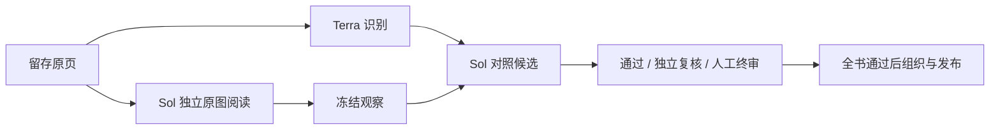

# 单页延迟与多页吞吐策略

该策略在[事务化执行引擎](EXECUTION-ENGINE-20261105.md)上实现，所有模型推理仍由原生 Codex 子代理完成。Terra 识别、Sol 原图审核/独立复核及整书组织的模型与内容门槛保持不变；不以跳过审核换速度。

## 执行方式

原来的串行依赖是 OCR 完成后，审核代理再启动、阅读原图并比较候选。现在 Sol 可在 Terra 识别时读取同一页原图，先冻结独立观察，再等待候选。冻结阶段没有候选正文或其哈希；绑定到具体审核租约时，校验原 PDF、页图、页码、代理身份与观察哈希。绑定后不能改写观察。疑点仍按冻结策略进入独立复核或人工终审。



同角色代理连续领取最多八页，累计处理 48,000 字符后轮换；不同角色不互换，修正提议者不能复核自己的修正。原图已冻结时不重复发送相同整页像素。组织任务直接取得第一批完整已审文字，随后按游标读取，每批最多八页、通常不超过 16,000 字符；单页过长时整页保留，不截断脚注或表格。逐页哈希必须与组织任务的冻结快照一致。

最后一项组织结果提交成功后，程序立即走原有全书证据校验与发布门槛，使阅读资料不必等待协调代理收尾。组织结果提交与发布各自保留可恢复提交；中途失败仍可幂等接续。该步骤不授予任何新的内容批准，暂停/取消优先，未解决页面仍阻断发布。

并发在工作区统一准入，启动、预热、等待、处理和冷却会话共用名额，不因打开第二本书翻倍。真正的审核积压与将来需要审核的页面分开计算；识别和审核各有至少三个实测样本后才按耗时比调整，避免拿实测值与默认估值比较而过早退出暖代理。当前页不中断，阶段分配沿用稳定窗口。

阶段结束后，速度采样窗口停在最后一项结果，不因用户留在页面上而持续下降；审核窗口从实际原图阅读开始，计入发生在候选生成之前的预读。

新工作区默认 14 个共享名额、八页暖会话和原图预读；既有未配置工作区保留七名额、两页会话，不自动改变原任务。`execution-policy.json` 可显式设置 2–64 个名额；这只是程序上限，不代表账号或服务端承诺的吞吐。限流后的“五分钟直接恢复”已由[持久化容量恢复](RUNTIME-RECOVERY-20261106.md)替代：按账户或模型降速、退避、单真实任务探测，并依据实际提交结果逐档恢复。程序接管已暴露的协调器和子代理错误；MCP 上报保留兼容，未暴露故障按超时回收，不伪装为原件不清。

## 设置与回退

在需要调整的同一工作区执行，然后重启其执行器，使新 CLI 的原生线程上限同时更新：

```powershell
uv run --no-sync --project services/codex-pipeline --locked python -m hrs_codex.cli --root 'D:/workspace' configure-execution --capacity 14 --batch-pages 8 --overlap-reading
```

执行策略回退使用 `--capacity 7 --batch-pages 2 --no-overlap-reading`。减少上限只约束新任务，不杀掉正在处理的页面。配置不修改冻结的内容审核策略、人工草稿或历史发布版本；备份 v2 保存配置，临时服务退避不作为永久恢复配置。旧 JSON 工作区仍须先停机迁移才能继续执行。

## 本地验证

本地证据位于 `output/throughput-20261105/`，沿用跨午夜前建立的目录名。单页与六页使用同一份既有校准材料；多页固定为《八路军驻新疆办事处研究》父 PDF 物理 18–41 页，共 24 页。保留原件与子集 SHA-256，所有档位输入字节相同。此处用于性能比较，不宣称未知样本准确率验收。

单页最终代码测试：发布就绪由 194.561 秒降至 82.887 秒，减少 **57.4%**；包括协调器清理的运行总时间由 209.920 秒降至 117.070 秒，减少 **44.2%**。识别与审核完成由 130.012 秒降至 74.474 秒。相同六页在即时发布改动之前，已由上一版 391.953 秒降至 239.956 秒，减少 38.8%。这些单页/六页运行最终均机器通过、组织完成并发布，无人工放行。早期单页试跑 125.843 秒保留原记录，不以其代替最终实现数据。

24 页同字节材料的最终调度比较如下。流水线指标包含识别、独立审核及本次实际触发的修正复核；尚不包含整书组织与索引。机器裁决有波动，各档实际复核数与人工待办分别列出，没有通过人工代签对齐结果。

| 配置名额 | 首轮识别审核完成 | 含独立复核完成 | 流水线吞吐 | 复核任务 | 最终页面 |
| --- | ---: | ---: | ---: | ---: | --- |
| 7 | 307.09 秒 | 376.77 秒 | 3.822 页/分 | 3 | 23 通过、1 待人工 |
| 14 | 220.52 秒 | 261.88 秒 | **5.499 页/分** | 1 | 24 通过 |
| 28 | 251.60 秒 | 292.23 秒 | 4.928 页/分 | 2 | 24 通过 |

因此本机选用 14 档，较 7 档本轮流水线吞吐提高 **43.9%**，完成耗时减少 30.5%；仅比较首轮识别审核，吞吐提高约 39.3%。14 档与 28 档均实际完成整书组织及发布；包含协调器收尾的总时间分别为 397.09、428.12 秒，不能将待人工的 7 档墙钟时间直接当作同等发布成绩比较。该曲线在即时发布触发改动前完成；即时发布不改变这些识别/审核/复核时间，其效果另外由最终单页和网页实际上传验证。

28 档最低可用物理内存约 352 MiB，且没有吞吐收益，因此未继续盲目扩大模型并发。程序 64 名额上限另由四个并发调度器的合成协议测试验证，**不表示实际跑过 64 个模型代理，也不表示账号的永久极限**。本表是固定材料、当时服务状态与本机负载下的单次比较；7/14 档部分时段还存在本地回归进程，不能当作严格隔离的容量基准或未来速度保证。

一次 28 档旧容量采样记录出现 29，原因是会话与租约两次查询跨越交接提交，导致瞬时重复计数；原始记录保留。现已统一为同一 SQLite 读事务、同一采样时刻，并用交错提交测试复现并修复。这不是 29 个模型实际同时运行的证据。

对应 CLI 的原生协作事件与激活会话时间另行交叉核对：三档原生子代理打开峰值分别为 7、14、28，均无协作调用失败，最终全部关闭，排除了只预留名额而未真正启动代理的情况。见本地 `native-capacity-verification.json`。

最终验证覆盖不可改写的预读、准确页面验签、代理身份独立、上下文轮换、容量共享、启动失败退避、发布门槛及幂等提交。原生备份实际恢复至新目录，文档与执行配置深比较相等；正式 825 页 JSON 检查点和用户原有 conversion.py 修改逐字节保留。上一轮独立 20 页的阅读、脚注、实际语义检索、Markdown、完整证据及未解决页面发布阻断也重新通过。

最终代码回归：原生 **167 passed**；平台/runtime-support/scripts **408 passed，15 skipped**；Ruff 格式及规则检查、Git 空白检查通过。前端代码、依赖和 OpenAPI 没有变化；此轮通过真实应用内浏览器验证上传、自动处理、正式阅读、原图对照、脚注往返，API 补验两条脚注、Markdown 导出和六条实际语义检索命中及出处范围。网页新书的组织提交至原生发布仅间隔 0.0203 秒；没有调用人工放行，既有四份原生文档的页面、任务和发布记录哈希均保持不变，原有三页人工待审保留。

`verification.json` 保留各档完整数据；`before-web-update.json` 和网页验收记录核对已有页面与任务未被更新过程改写。真实 PDF、数据库、运行日志和图片留在被忽略的本地输出目录，不进入 Git。测试范围为流程、来源和性能，仍不认证史料内容准确率。
