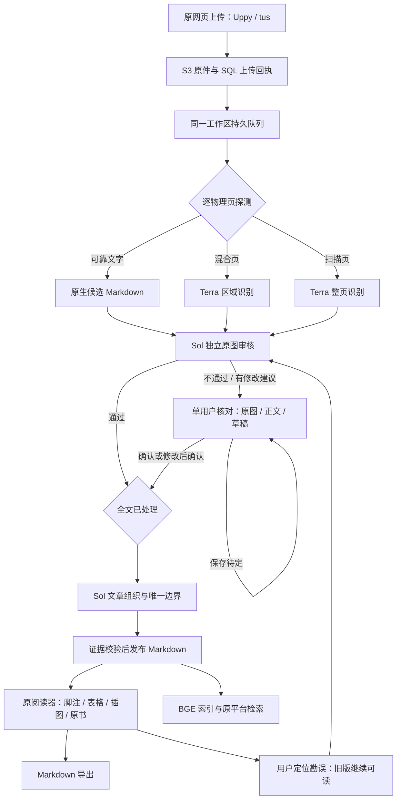

# 原项目功能与 Codex 融合验收（2026-11-04）

本轮 **20 页真实史料的流程顺序与交付格式验收通过**。5 份材料均经原 React 上传入口进入同一持久队列，原生执行器最终 `succeeded`，本地发布 `published`，原平台索引 `completed / complete`。生成 13 个阅读章节、23 条已关联脚注，保留 2 个组织图原图引用。没有新建史料卡任务。

这不是识别准确率认证。用户明确授权本轮审批放行，仅验证流程顺序与格式；10 页按机器审核通过，另 10 页以 `workflow_test` 放行，`human_approval=false`、`content_verified=false`。原始疑点、反对读法、修改前文本与证据仍保留。旧默认工作区的郭村、宁夏争议没有被此次隔离测试关闭。

[机器验收证据](evidence/integration-20261104.json)保存逐页源/页图/正文哈希、原图观察哈希、阶段时间、机器结论、工作流放行范围、出版及导出哈希、实际子代理模型与浏览器检查。原 PDF、全文、访问令牌、完整模型事件与会话日志不提交仓库；本地详细产物位于 `output/codex-integration-20261104/`。

## 最终流程



后台调用形态为 `codex exec` 协调器和原生角色子代理，经本地 stdio MCP 领取/提交任务。MCP 只保管原件、队列和证据，不执行模型推理。OCR 固定为 `historical_ocr / gpt-6.1-terra`；独立审核和组织为 `historical_review`、`historical_organization / gpt-6.1-sol`。本次从实际 spawn 事件追踪了 30 个工作线程，并从对应会话的 `agent_role`、`turn_context.model` 验证模型，未仅依赖配置值推断。

## 原有能力对应关系

| 原有能力 | 当前适配与验证 |
| --- | --- |
| 上传与续传 | 原 React Uppy / tus 保留；主机 API 同源代理上传，完成 hook 自动进入 Codex 队列，不需回到聊天再次启动。真实 5 文件上传完成。 |
| 原生、混合、扫描 PDF | 本次 5 页原生候选、1 页混合、14 页扫描；Terra 实际处理 15 页，20 页均由 Sol 独立原图审核。原生提取不能自行授予通过。 |
| 原图优先、内容审核 | 原图打开 → 冻结原图观察 → 候选比较 → 结构化裁决，哈希和时间绑定。新策略审核不通过直接交人工，不自动循环修订；旧 verify 协议兼容保留。 |
| 单用户人工处理 | 无需姓名、审核意见和重复确认复选框；确认、编辑确认、保存草稿。模型建议需显式采用；原图、失败原因、草稿与旧决定保留。 |
| 文章组织与页码 | Sol 组织；同页分篇要求唯一文字锚点，标题 Markdown 开始标记随标题归属。逐页正文拼接与章节正文拼接完全相同，没有漏字或重复。 |
| 脚注及注释归属 | Markdown 脚注、圈码、sup、星号显式 ID，以及行内（1）/〔1〕/(1)与唯一显式定义；支持同篇跨页注释。保留译者/编者/作者归属，歧义保持不链接，不猜最近注释。条目开头的括号序号不推断为注号。 |
| 脚注跳转与返回 | 原阅读器、识别底稿及待审正文共用原脚注解析；跳转和返回在正文内部完成，不改变 HashRouter 的书籍地址。实测英文长注、文选跨页括号注号、表内译者注。 |
| Markdown 导出 | 脚注转换成章节内唯一命名空间，保留多段注释缩进；不同篇同号注释不冲突。缓存同时绑定正文版本与验收范围。流程测试导出明确携带 `content_verified: false` 注释。浏览器实际下载 FRUS / CHENYI，与对象哈希一致。 |
| 表格、跨页表与续段 | HTML 合并单元格和逐页原图保留；Codex 提供的来源锚点及合并候选沿用旧结构一致性校验。候选缺失或无法核定时保留逐页原结构。真实样本验证两张续表、rowspan、译者注；集成夹具另验证两页表合并为一张且脚注与原文偏移不丢失。 |
| 插图、组织图 | 本地保留图路径映射到原平台原图对象；真实两幅组织图均可加载。图示原件保留，不能用生成文本替换不可确认的结构。 |
| 检索与证据补充 | 原 OpenSearch + BGE 嵌入/重排保留；词法和语义检索均实测，脚注、注释所属正文、表头等仍作来源绑定的补充。6 组查询返回范围与原章节 Unicode 字符偏移逐项一致。 |
| 勘误与发布版本 | 原平台定位勘误入口进入新候选与 Sol 复核；旧出版/旧人工决定归档并继续可读、可检索。新版通过组织后替换阅读投影，再建立新索引；新导出不会命中旧版本缓存。 |
| 删除 | 先取消本任务持有的原生执行，再清理工作区副本、上传暂存、SQL/S3/索引。共享原件仍有其他书籍引用时保留；原用户导入文件不删。真实存储集成测试验证双引用与执行中取消。 |
| 中断与恢复 | 队列、租约、阶段回执、正文及错误持久化；技术失败退避，三次后等待显式恢复；内容失败进入人工队列。多次 API 重启后仍为 20 次独立页面审核，没有因网页重启重做已完成内容阶段。 |
| 历史资料与史料卡 | 历史 SQL/S3、迁移、只读卡片与导出保留。新卡片生成、重试和调度维持退出；不自动迁移或重跑历史任务。 |

完整网页入口保留 PostgreSQL、S3、OpenSearch 及 BGE 检索运行时；默认识别不再依赖 Temporal、Qwen、Paddle 或 DeepSeek。`--legacy` 才进入历史运行路径。独立 MCP 工作台可单独使用；完整网页上传不能再次导入成第二份任务。

## 20 页来源

所有样本均从本地保留的真实 PDF 抽取原始页流与资源，未重新打字或制成合成 PDF。源图选取审计独立打开了全部 20 页；父文件和摘录哈希见 JSON。

| 样本 | 父 PDF 物理页 | 页数 | 本地文档 ID | 终态 |
| --- | --- | ---: | --- | --- |
| FRUS 1969–1976, XVII | 1、100–104 | 6 | `29b87c58cc05613f3357bc97` | 发布、执行成功、索引完成 |
| 陈毅军事文选 | 119–124 | 6 | `4a25da63c89fd31ae22b3d45` | 发布、执行成功、索引完成 |
| 中国共产党组织史资料第三卷 | 510–513 | 4 | `36f1b3dcb32735768401375d` | 发布、执行成功、索引完成 |
| 宁夏史料 | 41–42 | 2 | `6e892682cea361e55dc4fb10` | 发布、执行成功、索引完成 |
| 真实战争史续表材料，书目身份未认定 | 74–75（印刷63–64） | 2 | `12759dedf1c429a0f03445e8` | 发布、执行成功、索引完成 |

FRUS 父文件来自[美国国务院历史办公室](https://static.history.state.gov/frus/frus1969-76v17/pdf/frus1969-76v17.pdf)。其余材料按已保留本地文件记录来源，不补写未经核验的书目身份。

隔离工作区为 `state/codex-integration-20261104`，ID `adc9d0d710a94b80ad0b21e67b6381b4`。验收 UI 为 `http://127.0.0.1:18172/`，没有把流程测试放行写入正式默认工作区。保存的实际读法问题仍可在 JSON 和工作区机器回执中查看。

## 工程与浏览器验收

- Python 最终全量：**489 passed、15 skipped**，JUnit 位于 `reports/fusion-final-notes-all.xml`，哈希已记录。
- React：**34 tests passed**；TypeScript、生产构建、未使用代码检查通过。
- CI 保留转换策略兼容检查：87 passed、14 skipped、8 subtests passed；独立脚本测试收集 7 项通过。
- Ruff、Git diff 空白检查通过；API 与 Web Docker 镜像构建通过；Docker 到主机回环 HTTP hook 的真实探测通过。
- IAB 浏览器实际操作：5 文件上传、10 页授权流程放行、待审脚注、跨页脚注跳转/返回、表格译注、语义检索与注释展开、组织图加载、原 PDF 对照、Markdown 下载、最终 5 书均显示“已入库”。
- 单独的隔离技术夹具覆盖无法定位分篇拒绝、全文完整性、无早入库、修订后重建索引、导出缓存更新、表格合并和删除取消。夹具结果不计入真实史料准确率。

运行完整入口：

```powershell
uv sync --project services/research-platform --locked --group dev
npm --prefix services/review-workbench ci
uv run --no-sync --project services/research-platform python scripts/hrs_v2.py up --build
```

正常入口监听 `127.0.0.1:18170`。已发布数据与待审草稿持续保存；当前启动器不是操作系统开机服务。首次部署仍需按平台说明准备共享存储和 BGE 检索模型。本轮不覆盖整库迁移、所有历史版式或全项目边界加固，也不把机器/流程测试结果写成 sealed gold。
