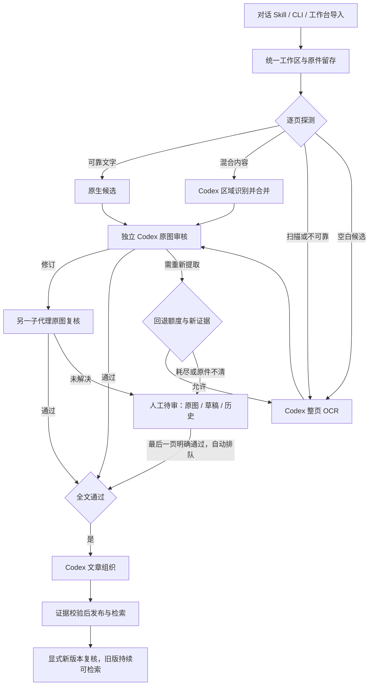

# Codex local pipeline

默认入口见[根 README](../../README.md)。该模块只在本机执行原件留存、PDF/图片渲染、队列与入库校验；所有识别和内容判断由 Codex 原生子代理完成。[工作流契约](src/hrs_codex/workflow.md) 同时供 MCP 和协调器读取。

默认工作区的后台处理、原图优先协议、人工交接与网页实测见 [融合验收](FUSION-VALIDATION.md)。郭村报告的“政／攻”争议与[此前宁夏材料](ACCEPTANCE.md)的一字不清仍待人工判断。[统一流程验收](UNIFIED-VALIDATION.md) 保留此前路由、恢复及版本测试记录。

## 统一入口

```powershell
uv run --no-sync --project services/codex-pipeline --locked python -m hrs_codex.cli start 'D:/materials/source.pdf'
uv run --no-sync --project services/codex-pipeline --locked python -m hrs_codex.cli workbench
```

`start` 返回文档 ID、实际工作区 ID 和工作台网址，提交持久队列并启动执行器。工作台提供导入、任务进度、原图、人工待审和已入库检索；浏览器关闭后，已提交的检查点及后台处理继续保留。后台进程退出后，下次打开工作台恢复队列；它不是操作系统开机服务。默认配置为 [historical-workspace.json](../../.codex/historical-workspace.json)，显式 `--root`、环境变量 `HRS_CODEX_ROOT` 可选择独立工作区。

网页按持久状态变化自动更新，保留导入输入、当前审核页与未提交正文；提交失败仍停留原表单，临时断线自动重连。另一窗口更新同页后会保留本地编辑并阻止旧版本提交。保存待审草稿保持同一物理页；确认最后一页才自动进入文章组织。工作台复用会核对实际工作区和执行器健康，避免仅网页存活而运行器已停止。

先用 `uv sync` 安装依赖，常驻运行使用 `uv run --no-sync ... python -m hrs_codex.cli`，MCP 项目配置也使用模块入口。这样 Windows 上的常驻控制台启动器不会阻止后续更新。执行协调器逐字加载项目 skill，并仅向运行子代理开放 MCP；无需依赖桌面安装目录中的 shell。开发对话的工具不受影响。

导入时逐页探测：可靠文字进入原生候选；有独立图像/描边区域时合并原生候选与区域识别；扫描、隐藏 OCR、坏字符映射或不确定几何进入整页 OCR。空白候选也需要原图审核。探测保存证据，不授予内容批准。原生/混合路径失败可回退整页 OCR 一次，整页重试还须新的原图证据且限一次；多轮不确定进入人工队列。运行故障与内容问题分别记录，技术重试退避并在三次失败后等待显式 `resume`。



## 工具

| MCP 工具 | 用途 |
| --- | --- |
| `workflow_instructions` | 读取协调步骤、分工和提交契约 |
| `workspace_status` / `open_workbench` | 确认工作区身份，启动或复用工作台与执行器 |
| `process_document` / `resume_document` | 一次导入并排队，或显式恢复技术故障 |
| `prepare_document` | 低层导入：留存原件、渲染物理页、探测并生成提取/审核任务 |
| `list_documents` / `document_status` | 查看文档、干净内容和待办 |
| `approved_page_text` | 组织代理按页读取已审全文，避免重复传输整本书 |
| `claim_task` / `task_details` | 领取有过期时间的任务，读取带哈希输入 |
| `original_image` | 返回原页图像像素及 SHA-256 |
| `review_candidate` | 冻结带原图回执的观察与不确定项，然后开放审核/验证候选；没有观察不能提交机器批准 |
| `original_detail` | 从原 PDF 以 432 dpi 重渲染指定区域，或从原始图片取原生像素细节，保存哈希证据 |
| `human_review_queue` | 读取待人工审核的页面、未解决次数及原因；只读，不代替人工裁决 |
| `request_human_review` | 独立终验仍有原图读法争议时，以当前文本/原图哈希和细节证据交接人工；保留版本并暂停自动重跑 |
| `submit_task` | 提交有租约、输入哈希与结构校验的机器结果 |
| `retry_task` | 保留旧裁决并重开待处理任务 |
| `fallback_page` | 带原因、新证据和次数限制的内容回退 |
| `begin_revision` | 开启显式复核版本，保留原发布快照和人工记录 |
| `publish_document` | 全文与文章组织通过后发布 Markdown |
| `search_library` | 在已发布文本中检索，返回页码与原图证据 |

并行子代理共享文件锁和原子 JSON 检查点。此版本按单机个人工作区实现，检索使用已审文本的直接子串匹配；暂不引入向量服务、外部任务队列或账号体系。

新 MCP 审核/验证任务的候选默认隐藏。`original_image` 携带任务 ID 与租约后返回原图回执，代理记录关键用词、专名、数字、否定因果及结构，再调用 `review_candidate` 获得候选。原图观察冻结后不能重写；观察仍有未解决内容时不能批准。最终裁决绑定观察哈希，失败记录和人工待审历史也保留观察。旧已完成决定及已领取的兼容契约保持可追溯。

原图复核不通过时，显式重试会重新打开原始 OCR 的审核，再提出新修订并由独立子代理复核；旧候选、失败裁决和任务输入快照保留。原件不清的内容仍保持待核对，重试本身不代表通过。

小字、无法识别的字符或读法冲突应先调用 `original_detail` 检查原始证据。细节区域使用归一化边界 `[left, top, right, bottom]`；原 PDF 重渲染后再裁切。扫描源的实际像素不足时，提高渲染 DPI 不会补出缺失信息，仍应待审。细节图片和来源元数据存于文档的 `evidence/details/`，由提交结果的 `original_details` 列表引用；提交及后续读取会校验来源、页码、文件哈希和元数据。

## 人工审核

原图细节重试后仍不确定的页面交给人工；所有待审页面自动进入人工队列，多轮失败显示累计未解决记录。无需一直重跑模型。启动当前工作区的本地审核页：

```powershell
uv run --no-sync --project services/codex-pipeline --locked python -m hrs_codex.cli --root state/codex review
```

打开终端输出的网址。界面并排展示原图和正文，可放大查看由原件重渲染的页面、查看 OCR 初稿和历史修订；清晰度仍受原始扫描限制。填写审核人及依据后，可以修订正文并“确认整页通过”，也可以“保存草稿，继续待审”。审核页只监听本机回环地址，网址含本次启动的访问凭据；重启后使用新网址。

人工决定保存输入快照、原件与页图哈希、修改后正文和原因，页面批准标记为 `human`。机器结果始终保持 `machine`，Codex 不得代填真实史料的人工裁决。姓名为本机操作者填写的署名，不作身份认证或 sealed gold 认证。历史机器失败记录和人工草稿保留；机器重试不能覆盖人工待审草稿。

全部页面通过后自动排队，由工作台执行器继续文章组织和发布。无需再向对话发送继续指令；工作台尚未运行时，下次打开即可接续。显式技术恢复使用 `hrs-codex --root <工作区> resume <文档ID>`，同步诊断使用 `run`。仍有一页未解决就继续阻断发布。人工审页、机器组织的发布回执标为 `mixed`，列出 `human_reviewed_pages`；整份文档的 `human_approval` 仍为 false，因为文章组织没有人工批准。

## 产物

```text
state/codex/
  .workspace.json          持久工作区身份
  .workbench.json          本次工作台进程与本机访问凭据（不提交仓库）
  documents/<source-sha256-first-24>/
    source.pdf|png|jpg|tif    原件字节
    pages/*.png             渲染页及工作副本
    render.json             渲染清单与原件/页图哈希
    document.json           页、任务、OCR/修订/审核、文章映射
    document.md             全部通过后的文本
    publication.json        机器入库回执与哈希
    revisions/              不可覆盖的已发布正文、清单和回执快照
  runs/<document-id>/<timestamp>/
    request.json            协调器指令
    events.jsonl            Codex 原生执行事件（含子代理活动）
    stderr.log
    summary.txt
    receipt.json
```

`document.json` 的 `pages[].ocr` 保留初稿，`candidate` 保留修订，`approved` 保存通过的最终正文；`tasks[].result` 与 `receipt` 保留历史结果。图片原件可能有独立的归档页和审核工作副本，两者均保留。

CLI 的 `--root` 选项位于子命令前。以复制整个工作目录进行本机备份，恢复后通过 `status`/`run` 继续。渲染清单含绝对路径，移动目录时应保留原路径或从原件导入新工作区；不要手动改证据哈希。

MCP 使用官方 Python SDK 2.2.0 的 stdio 传输。启动工具为 `uv run --no-sync --project services/codex-pipeline --locked python -m hrs_codex.cli mcp`。该进程不调用模型 API、不加载本地视觉或 OCR 模型；模型连接与子代理生命周期由 Codex 管理。

接入方式依据 [OpenAI 本地 MCP 文档](https://developers.openai.com/codex/mcp)、[原生子代理文档](https://developers.openai.com/codex/subagents) 和 [MCP Python SDK](https://py.sdk.modelcontextprotocol.io/)。本地 MCP 的工具预批准仅限项目注册的服务；协调器保留 workspace-write 沙箱。
